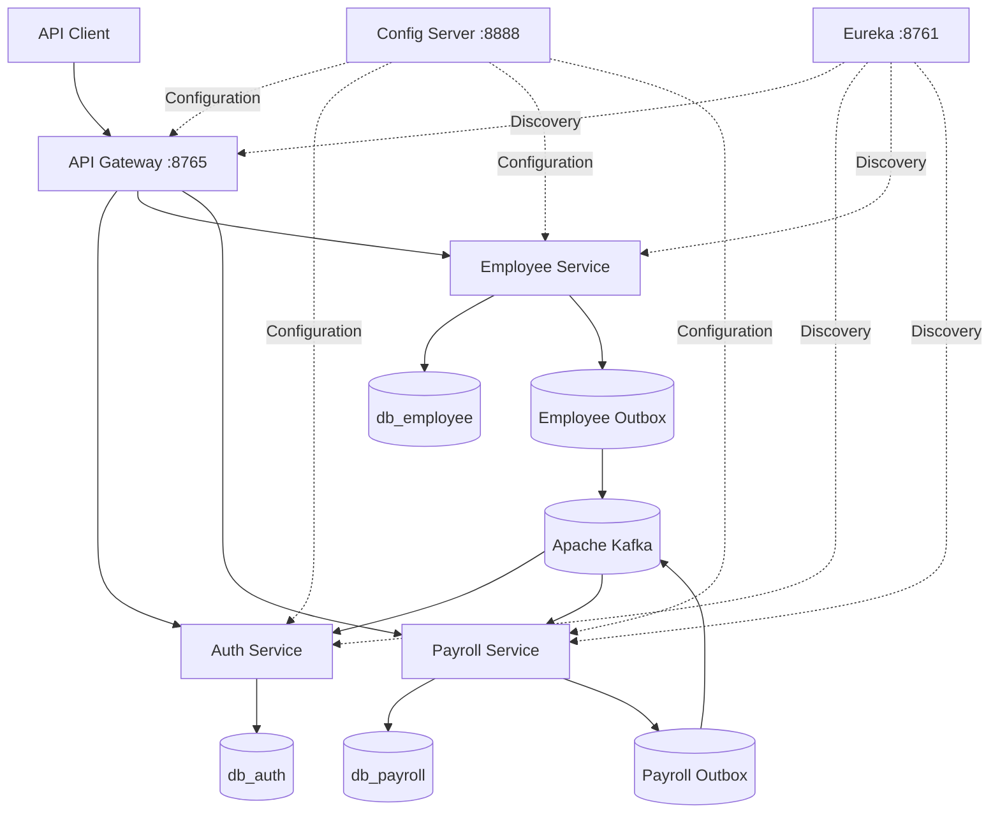
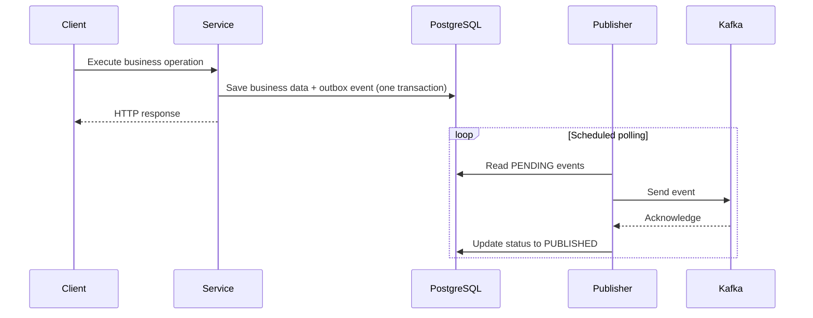

MS_HR — Event-Driven HR & Payroll Microservices
Java 21 | Spring Boot 3.4.5 | Spring Cloud | Apache Kafka | PostgreSQL | Docker

A microservices-based Human Resources and Payroll backend focused on secure REST APIs, asynchronous communication, and reliable event publishing.

Source code · Current reference: tag2
Portfolio and educational project. Not intended as a production payroll or financial settlement platform.

Key Features
- JWT authentication and role-based authorization (RBAC)
- Employee management, activation/deactivation, position updates and vacation requests
- Payroll operations, salary calculations, 13th salary, vacation payments and cancellation
- Event-driven integration with Apache Kafka
- Transactional Outbox in both Employee and Payroll services
- Independent PostgreSQL databases with Flyway migrations
- Service discovery via Netflix Eureka and centralized configuration via Spring Cloud Config
- Docker Compose orchestration with health-aware startup dependencies
- Unit tests and manual integration tests for Kafka outage recovery
  Architecture

Each business service owns its data logically. In the local Docker environment, the three databases run on one PostgreSQL instance.
Services
Component	Responsibility	Host port
API Gateway	Entry point, JWT validation, routing	8765
Auth	Login, registration, JWT issuance	Internal / dynamic
Employee	Employees, positions, vacation requests	Internal / dynamic
Payroll	Salary and vacation payments, cancellation	Internal / dynamic
Eureka	Service discovery	8761
Config Server	Centralized configuration from Git	8888
PostgreSQL	Persistent data and outbox tables	5432
Kafka	Event transport	9092

Transactional Outbox
The project addresses the dual-write problem: a business transaction may commit while a direct Kafka publication fails.

Employee and Payroll save business data and an outbox record in the same database transaction. A scheduled publisher reads PENDING records, publishes them to Kafka, and marks them PUBLISHED after acknowledgement.

Kafka Topics
Producer	Topic	Business event
Employee	employee-activated-event	Employee activated
Employee	employee-deactivated-event	Employee deactivated
Employee	employee-position-updated-event	Position updated
Employee	vacation-approved-event	Vacation approved
Payroll	payment-created-event	Payment created
Payroll	payment-canceled-event	Pending payment canceled
Payroll	payment-refund-requested-event	Paid payment canceled; refund requested

The current implementation uses employee ID as the Kafka message key. Kafka ordering applies within a topic partition, not across different topics.

Reliability note: Outbox publishing provides at-least-once delivery semantics. A duplicate event is possible if Kafka acknowledges a message but the database update fails. Consumers should handle duplicates idempotently. Multiple publisher replicas would require additional coordination.
Technology Stack
Category	Technologies
Language	Java 21
Framework	Spring Boot 3.4.5, Spring Cloud 2024.0.1
Security	Spring Security, OAuth2 Resource Server, JWT
API	Spring Web, Spring Cloud Gateway, Bean Validation
Discovery and configuration	Netflix Eureka, Spring Cloud Config
Messaging	Apache Kafka 3.8.1, Spring Kafka
Persistence	PostgreSQL 16, Spring Data JPA, Flyway
Integration	OpenFeign, Resilience4j
Tooling	Maven, MapStruct, Lombok, Docker Compose
Documentation	Springdoc OpenAPI / Swagger
Testing	JUnit 5, Mockito, Spring Boot Test

API Overview
All routes are accessed through the API Gateway at http://localhost:8765. Protected endpoints require an appropriate JWT.
Authentication
Method	Route	Description
POST	/auth/login	Authenticate and receive a JWT
POST	/auth/register	Register a user, subject to access rules

Login body:
{
"email": "user@example.com",
"password": "your-password"
}
Employee
Method	Route	Description
GET	/employees	List employees
GET	/employees/{id}	Find employee
GET	/employees/me	Current employee details
GET	/employees/active	Active employees
GET	/employees/inactive	Inactive employees
GET	/employees/{id}/salary	Salary details
POST	/employees	Create employee
PUT	/employees/{id}/update	Update position
PUT	/employees/{id}/activate	Activate
PUT	/employees/{id}/deactivate	Deactivate
POST	/employees/vacation-requests	Request vacation
GET	/employees/vacation-requests/me	Own vacation requests
PUT	/employees/vacation-requests/{id}/approve	Approve vacation
PUT	/employees/vacation-requests/{id}/reject	Reject vacation

Payroll
Method	Route	Description
GET	/payments	List payments
GET	/payments/{id}	Find payment
GET	/payments/me	Current employee payments
GET	/payments/employeeId/{employeeId}	Employee payments
POST	/payments	Create salary payment
POST	/payments/launch	Launch payroll
POST	/payments/13salary	Calculate 13th salary
POST	/payments/vacation	Calculate vacation payment
PUT	/payments/{id}/status	Update payment status
PUT	/payments/{id}/cancel	Cancel payment / request refund
GET	/payments/vacation-requests	Vacation-related payments
GET	/payments/vacation-requests/{vacationRequestId}	Find vacation payment

Example payment request:
{
"employeeId": 1,
"daysWorked": 30,
"referenceDate": "2026-10-24"
}
The employee must exist and the reference date cannot be in the future.
Running with Docker
Requirements
- Docker Desktop / Docker Engine with Compose
- Git
- Appropriate access and credentials for the configuration repository
1. Clone and select the current reference
   git clone https://github.com/Viniciuss27/MS_HR.git
   cd MS_HR
   git checkout tag2
2. Configure .env
   Create .env at the repository root. Example variable names and Docker hostnames (replace placeholder secrets and align settings with the configuration repository):
   DB_USER=postgres
   DB_PASSWORD=replace-me
   DB_HOST=postgres
   DB_PORT=5432
   DB_AUTH=db_auth
   DB_EMPLOYEE=db_employee
   DB_PAYROLL=db_payroll

KAFKA_HOST=kafka
KAFKA_PORT=9092
GROUP_ID=your-consumer-group

EUREKA_URI=http://eureka:8761/eureka/
SPRING_CLOUD_CONFIG_URI=http://config-server:8888

GIT_USERNAME=your-github-username
GIT_PASSWORD=your-github-token

JWT_SECRET=replace-with-a-secure-compatible-secret
JWT_EXPIRATION=configure-according-to-the-application
Never commit .env or actual credentials. Some settings, including Kafka consumer group and JWT secret format, depend on the application's external configuration.
3. Start
   docker compose config --quiet
   docker compose up -d --build
   docker compose ps
   Docker Compose waits for Config Server and Eureka health checks before starting dependent services. Other dependencies currently use container-start checks, not full readiness checks.
4. Verify
   Open Eureka Dashboard. Expected registrations:
- AUTH
- CONFIG_SERVER
- EMPLOYEE
- GATEWAY
- PAYROLL
  Other endpoints:
- Gateway: http://localhost:8765
- Config Server health: http://localhost:8888/actuator/health
5. Stop
   docker compose down
   This preserves named volumes. Avoid docker compose down -v unless you intend to delete database and Kafka data.
   Testing
   Unit tests
   Run Maven tests from an individual service directory:
   cd Payroll
   ./mvnw test
   On Windows PowerShell:
   cd Payroll
   .\mvnw.cmd test
   Repeat for Employee and Auth. The project includes service-layer, Kafka consumer and outbox tests.
   Kafka outage and recovery: manually validated
   The following scenario was executed successfully:
1. Start the application with Docker Compose.
2. Stop Kafka: docker stop hr-kafka.
3. Create a payment via the API.
4. Verify its event is persisted as PENDING.
5. Restart Kafka: docker start hr-kafka.
6. Verify the event changes to PUBLISHED.
   Inspect the Payroll outbox:
   docker exec hr-postgres psql -U postgres -d db_payroll -c   "SELECT id, topic, event_key, status, published_at FROM tb_outbox_event ORDER BY id DESC LIMIT 10;"
   The same test session verified successful publication of:
- payment-created-event
- payment-canceled-event
- payment-refund-requested-event
  PUBLISHED confirms producer acknowledgement and outbox status update, not end-to-end consumer processing or an actual financial refund.
  Repository Layout
  MS_HR/
  ├── Auth/
  ├── Employee/
  ├── Payroll/
  ├── Gateway/
  ├── Eureka/
  ├── Config_Server/
  ├── docker/
  │   └── postgres/
  │       └── init.sql
  ├── docker-compose.yml
  └── README.md
  Engineering Trade-offs & Future Work
- Add automated end-to-end integration tests with Testcontainers.
- Expand consumer idempotency and duplicate-delivery tests.
- Coordinate outbox polling safely when running multiple replicas.
- Add distributed tracing, metrics, and centralized observability.
- Introduce CI checks for builds and tests.
- Harden secrets management for production-like deployments.
  Author
  Vinícius — Java Back-end Developer

GitHub Profile · MS_HR Repository